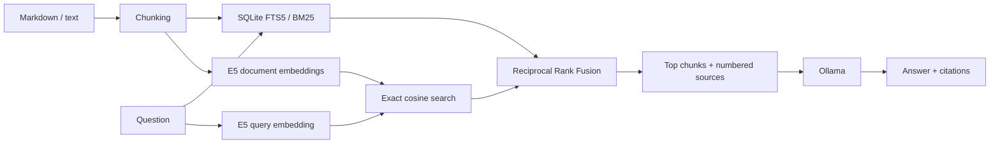

# Hybrid RAG Lab

Local document question-answering with BM25, multilingual embeddings, Reciprocal Rank Fusion, and cited answers generated by Ollama.

The project uses a small, fictional Italian HR/IT knowledge base. It exposes the retrieval results, preserves source references, and includes reproducible retrieval and generation checks. Python handles the pipeline directly, without an orchestration framework.

## Features

- Markdown and UTF-8 text ingestion with overlapping chunks.
- Three retrieval modes: BM25, semantic, and hybrid RRF.
- SQLite storage for text, metadata, vectors, and the FTS5 index.
- Local multilingual embeddings with E5-small through FastEmbed.
- Local answer generation with Ollama and numbered source citations.
- Evaluation datasets, raw answer reports, citation checks, and unit tests.

## Architecture



Default configuration: 160-word chunks, 30-word overlap, at least 10 candidates per retriever, RRF constant 60, and 3 final chunks. Semantic search is an exact NumPy scan; no external vector database is required. Reindexing replaces the entire corpus in that database.

## Requirements

- Python 3.11 or 3.12, with SQLite FTS5 support.
- [Ollama](https://docs.ollama.com/quickstart) for answer generation.
- Internet access for the initial embedding and LLM downloads.

Retrieval works independently of Ollama. After the models are downloaded, inference runs locally; no paid API key is required. Use a locally executed Ollama model. Ollama cloud features can be disabled with `OLLAMA_NO_CLOUD=1` when starting the server.

## Quick start

```bash
git clone https://github.com/BVGAL/hybrid-rag-lab.git
cd hybrid-rag-lab
```

Create an environment on Windows PowerShell:

```powershell
py -3.12 -m venv .venv
.\.venv\Scripts\Activate.ps1
```

Or on macOS/Linux:

```bash
python3.12 -m venv .venv
source .venv/bin/activate
```

Install and index the demo:

```bash
python -m pip install -e ".[dev]"
python -m hybrid_rag index data/demo
python -m hybrid_rag search "Come risolvo VPN-403?"
```

Start Ollama through its desktop application or `ollama serve` in another terminal, then download the model and ask a question:

```bash
ollama pull qwen2.5:7b
python -m hybrid_rag ask "Come risolvo VPN-403?" --model qwen2.5:7b
```

The answer uses references such as `[1]`. The CLI prints the corresponding filenames, chunk numbers, and source passages underneath. These numbers refer to the retrieved context for that question; they are not permanent document IDs.

## Commands

```bash
# Compare retrieval methods
python -m hybrid_rag search "Ho perso il telefono e non riesco ad accedere" --mode bm25
python -m hybrid_rag search "Ho perso il telefono e non riesco ad accedere" --mode semantic
python -m hybrid_rag search "Ho perso il telefono e non riesco ad accedere" --mode hybrid

# Use a different corpus and database
python -m hybrid_rag --db storage/custom.db index data/private
python -m hybrid_rag --db storage/custom.db search "La mia domanda"

# Run the local unit tests; no model download or Ollama needed
python -m pytest -q

# Evaluate retrieval with the actual embedding model
python -m hybrid_rag evaluate --top-k 1 --output reports/retrieval-k1.json
python -m hybrid_rag evaluate --top-k 3 --output reports/retrieval-k3.json

# Generate real answers and inspect their citation references
python scripts/evaluate_answers.py --model qwen2.5:7b
```

`--db` is a global option and must appear before the subcommand. Put private documents in `data/private/`, which is excluded from Git alongside model caches, databases, and `.env` files. The application accepts `.md` and `.txt` files; PDF ingestion is not implemented.

## Evaluation

### Retrieval

The demo contains **8 documents / 8 chunks and 16 labeled questions**, including two questions that require multiple documents. Metrics are measured at document level within the first k returned chunks. Duplicate chunks from the same source do not increase recall.

| Method | Recall@1 | MRR@1 | Recall@3 | MRR@3 |
| --- | ---: | ---: | ---: | ---: |
| BM25 | 0.5625 | 0.6250 | 0.8125 | 0.6979 |
| Semantic | 0.8750 | 0.9375 | 1.0000 | 0.9688 |
| Hybrid RRF | 0.6250 | 0.6875 | 1.0000 | 0.8125 |

Hybrid retrieval improves over BM25 on this demo but does **not** outperform the semantic baseline. The semantic baseline ranks relevant sources better. The corpus is small enough that all chunks enter the semantic candidate list; these results are smoke tests, not evidence of generalization.

Raw results: [k=1](reports/retrieval-k1.json), [k=3](reports/retrieval-k3.json). [Run metadata](reports/run-info.json) records package versions, the embedding model revision, and corpus hashes.

### Answer generation

The generation suite contains **8 development cases**: direct questions, a question requiring two sources, an incorrect premise, and two questions without an answer in the corpus.

Run `scripts/evaluate_answers.py` against a real Ollama server. It saves the exact prompt settings, model digest, generated answers, retrieved context, and citation numbers in [generation.json](reports/generation.json). It checks whether citation numbers point to available passages. It does **not** automatically establish that a passage supports the associated claim.

The saved run uses **Qwen 2.5 7B with Ollama 0.40.16**, temperature 0, seed 42, and a 4096-token context window.

| Check | Observed result |
| --- | ---: |
| Answerable cases returning citations | 5 / 6 |
| Out-of-range citation numbers | 0 |
| Correct abstentions on unanswerable cases | 2 / 2 |
| Incorrect abstentions on answerable cases | 1 / 6 |

The qualitative review found supported facts in the five cited answers, with an omitted exception in the meal-limit answer. The incorrect-premise case still abstains instead of correcting the amount. These are known limitations, not passing cases hidden from the report.

The saved run and its [qualitative review](reports/generation-review.json) document the observed behavior. The prompts were refined on these cases, so this is a development check, not an independent benchmark or an accuracy guarantee.

## Project structure

```text
src/hybrid_rag/
  ingest.py          document loading and chunking
  search.py          storage, BM25, embeddings, and RRF
  generate.py        source-grounded prompt and Ollama call
  evaluate.py        retrieval metrics
  cli.py             command-line interface
scripts/
  evaluate_answers.py
data/
  demo/              fictional Italian HR/IT documents
  evaluation.json
  generation-evaluation.json
reports/             measured results and review notes
tests/               unit and simulated HTTP tests
```

## Limitations

- Citations can be valid references without supporting the claims. Answers still need verification.
- Dense retrieval returns nearest neighbors even for unrelated questions. There is no calibrated abstention threshold.
- Prompt instructions reduce some errors; they are not a complete defense against document prompt injection.
- Word-based chunks may exceed tokenizer limits for unusual text. There is no PDF layout handling or OCR.
- Exact vector search loads the index into memory and is intended for small corpora.
- No authentication, document permissions, or multi-user isolation is implemented.
- Model tags and upstream embedding revisions can change. Rebuild the index when changing embedding models and record the revision when comparing runs.

## Next steps

- Expand the corpus and create a held-out evaluation set.
- Evaluate citation support and abstention beyond the development examples.
- Add PDF ingestion with page references and a small API or interface.
- Introduce reranking or a vector index only after measuring a concrete need.

## References

- [SQLite FTS5 / BM25](https://sqlite.org/fts5.html)
- [FastEmbed](https://github.com/qdrant/fastembed)
- [Multilingual E5-small](https://huggingface.co/intfloat/multilingual-e5-small)
- [Reciprocal Rank Fusion](https://qdrant.tech/documentation/hybrid-queries/)
- [Ollama generation API](https://docs.ollama.com/api/generate)
